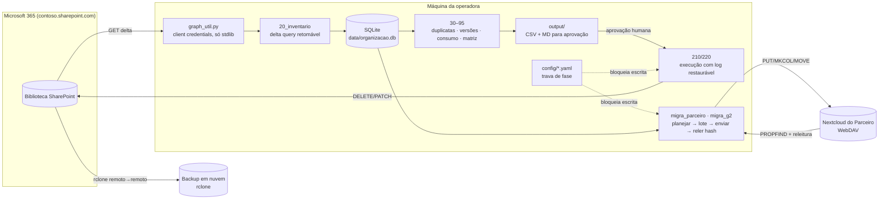

# Organização do SharePoint — diagnóstico, limpeza e migração auditável via Microsoft Graph

> **Summary in English.** A Python toolkit that rescued a corporate SharePoint document library that
> had blown past its storage quota (1,384 GiB used against a 1,024 GiB limit). It inventories ~138k
> files straight from the cloud through Microsoft Graph `delta` queries — reading the server-side
> `quickXorHash` instead of downloading a terabyte — finds exact duplicates, measures how much space
> sits in version history and recycle bin, and produces an approval-ready cleanup list. Execution
> happened only under explicit written approval, behind a phase lock in the config. Later fronts
> migrated ~29k files to a partner's Nextcloud over WebDAV with resumable uploads and per-file hash
> re-verification from the destination. The quota went down to 861 GiB. Fictitious data; this is a
> sanitized copy of a system in real use.

---

## Problema

A biblioteca SharePoint de um contrato de consórcio de infraestrutura rodoviária **estourou a cota**:
1.384,20 GiB usados contra um limite de 1.024 GiB, ~138 mil arquivos em 6 pastas de primeiro nível.
Havia prazo, ninguém sabia onde estava o espaço, e baixar o acervo para analisar inviabilizaria o prazo.
A pasta sincronizada localmente (OneDrive) era lenta, incompleta e não enxergava versões nem lixeira.

## Solução

1. **Inventário pela nuvem** (`scripts/20_inventario.py`): `GET /drives/{id}/root/delta`, paginado e
   **retomável** (o `nextLink` vai para SQLite a cada lote). Nome, caminho, tamanho, autor, datas e o
   `quickXorHash` vêm na listagem — nenhum byte de conteúdo é baixado.
2. **Duplicatas exatas** (`30_duplicatas.py`): duplicata é **hash igual**, não nome parecido; colisão
   de hash com tamanho diferente é separada e reportada.
3. **Consumo, versões e lixeira** (`40_versoes.py`, `50_consumo.py`): quanto do espaço é histórico de
   versões, quanto é lixeira, quanto é arquivo pesado sem valor documental.
4. **Matriz de decisão** (`60`–`95`): propostas para aprovação humana; nada é apagado pelo relatório.
5. **Execução sob trava** (`210_mover_lixeira.py`, `220_podar_versoes.py`): só com `fase` liberada no
   config e autorização escrita citada no próprio script; cada item vai para um log que permite restaurar.
6. **Migrações auditáveis** (`scripts/migra_parceiro/`, `scripts/migra_g2/`, `33x`–`38x`): cópia
   remoto→remoto (rclone `rcd` e motor WebDAV próprio com upload em partes retomável), cada arquivo
   **relido do destino** e conferido por QuickXor + SHA-256 contra a origem.

## Arquitetura



Peças principais:

| Peça | Papel |
|---|---|
| `scripts/graph_util.py` | cliente mínimo do Graph (client credentials, retry com `Retry-After`, paginação), só biblioteca padrão |
| `scripts/config_util.py` + `config/projeto.yaml` | trava de fase (`analise` / `execucao`); scripts de diagnóstico abortam fora de `analise` |
| `sql/01–04_*.sql` | esquemas SQLite: catálogo, versões, estado das migrações |
| `scripts/migra_parceiro/` | motor da migração: regras de classificação, EAP de destino, QuickXor, upload retomável, watchdog |
| `scripts/migra_g2/` | segunda migração: trava de escopo por árvore, governador de recursos, envio WebDAV, trava de exclusão |
| `tests/` | 13 arquivos de teste com dados fictícios e servidor WebDAV falso, sem rede |

## Números

Todos do `STATE.md` (snapshot sanitizado de 11/11/2026):

| Medida | Valor |
|---|---:|
| Arquivos catalogados pela nuvem | 138.344 |
| Cota usada: antes → depois | 1.384,20 GiB → **861,14 GiB** (limite 1.024 GiB) |
| Histórico de versões podado | 4.654 versões de 620 arquivos · 108,49 GiB |
| Backup antes de apagar (pasta protegida) | 2.313/2.313 arquivos · 275.831.036.044 B |
| Migração 1 (pasta compartilhada → Nextcloud) | 16.402 arquivos VALIDADOS por hash relido · 131,68 GiB |
| Migração 2 (G2, 4 rodovias → Nextcloud) | 12.795 arquivos VALIDADOS · 0 erro |
| Testes automatizados | 137 passed (11/11/2026) |

## Como rodar (com os dados fictícios)

Requer Python 3.12. Nada abaixo usa rede nem credencial.

```bash
pip install -r requirements.txt            # matplotlib (gráficos); o resto é biblioteca padrão
python examples/carregar_inventario_ficticio.py   # monta data/organizacao.db com ~20 itens inventados
python scripts/30_duplicatas.py --min-bytes 0      # gera output/duplicatas.md e .csv
python -m pytest -q tests/test_migra_regras.py     # exemplo de arquivo de teste isolado
```

O inventário fictício (`examples/inventario_ficticio.csv`) tem 4 grupos de duplicatas plantados
(PDF, planilha, DWG e um vídeo de 4 GiB) em `contoso.sharepoint.com`.

Para usar contra um SharePoint real: copiar `.env.example` para `.env`, registrar um app no Entra ID
com `Sites.Selected`, ajustar `config/projeto.yaml` e começar por `python scripts/10_testar_graph.py`
(somente leitura).

## Limitações conhecidas

- Feito para SharePoint Online via Microsoft Graph, com app registrado no Entra ID (`Sites.Selected`); a demo pública usa só um inventário fictício local.
- Entre provedores sem hash comum, a conferência de cópia cai para quantidade + bytes, que não prova conteúdo igual (D-07); na migração principal o hash é recalculado sobre os bytes lidos do destino.
- Arquivo gigante sem conferência integral fica marcado como `MONTADO_SEM_VALIDACAO_INTEGRAL` — caso do vídeo de 87,76 GiB da migração 1 (D-10).
- O servidor não aceita DELETE condicional em pasta: exclusão de pasta só depois de releitura recursiva vazia (D-13).
- Não há modo automático de limpeza: a execução depende da trava de fase no config e de autorização escrita.
- Num clone novo o banco SQLite não existe; é preciso rodar o inventário (ou o carregador fictício) antes dos relatórios.

## O que eu decidi × o que a IA gerou

O código foi escrito com Claude Code e Codex, sob especificação e revisão minha. As decisões abaixo
são minhas e estão registradas em `CLAUDE.md` e `docs/02_DECISOES.md`:

| Decisão (autora) | Onde |
|---|---|
| Trabalhar **100% pela nuvem**, usando o hash do servidor em vez de baixar o acervo | `CLAUDE.md`, regra 2 |
| Fase de análise **somente GET**; toda escrita exige autorização escrita na conversa, mesmo com o app tendo permissão de escrita ("o limite é de processo, não da permissão") | `CLAUDE.md`, regra 1 |
| Duplicata é hash igual; nenhuma conclusão sem o número que a sustenta | `CLAUDE.md`, regra 4 |
| Corte de revisões pela última revisão **aprovada**, nunca esvaziando uma disciplina | D-01 |
| Nada da pasta protegida sai sem cópia, **mesmo duplicado** (recusei a proposta de apagar sem copiar) | D-03 |
| Manter as 2 versões mais recentes de cada arquivo e podar o resto | D-06 |
| Critério de conferência da cópia: quantidade + bytes quando não há hash comum entre as nuvens | D-07 |
| Migração como frente isolada (config, trava e banco próprios), remoto→remoto, com hash relido do destino | D-08 |
| Encerrar a migração com a ressalva explícita do vídeo de 87,76 GiB em vez de esconder a pendência | D-10 |
| Migração G2 uma rodovia por vez, cedendo recursos ao projeto prioritário | D-11, D-12 |

Gerado com IA sob minha revisão: a implementação dos scripts, dos pacotes `migra_parceiro`/`migra_g2`,
dos esquemas SQL e dos testes; os relatórios automáticos.

## Stack

Python 3.12 (biblioteca padrão + `matplotlib`; `openpyxl`/PyYAML em scripts específicos) · SQLite ·
Microsoft Graph API (`delta`, `driveItem`, versões, cota) · rclone (`rcd`, remotes em memória) ·
WebDAV/Nextcloud (upload em partes) · PowerShell 5.1 (orquestração, DPAPI para credencial) ·
pytest · Claude Code e Codex.

## Documentação

- `CLAUDE.md` — regras permanentes do repositório.
- `docs/01_PLANO.md` — roteiro E0–E5.
- `docs/02_DECISOES.md` — resumo público das decisões técnicas D-01…D-16.
- `docs/migracao_parceiro/` — arquitetura, operação e plano-piloto das migrações.
- `docs/README-original-sanitizado.md` — README da fase inicial (análise).

## Verificação, sanitização e licença

- **Testes:** `py -3.12 -m pytest tests -q -p no:cacheprovider` → **137 passed** em 19/11/2026.
- **Dados:** fictícios — cópia sanitizada de um sistema em uso real; nenhum dado de cliente ou de terceiro.
- **Sanitização:** o que foi removido, trocado ou inventado nesta cópia está em [`SANITIZACAO.md`](SANITIZACAO.md).
- **Licença:** todos os direitos reservados; leitura permitida para avaliação de portfólio — ver [`LICENSE`](LICENSE) e [`NOTICE`](NOTICE).

---

**Aviso:** *Dados fictícios. Versão sanitizada de um sistema em uso real; identificadores do cliente
foram substituídos.*
